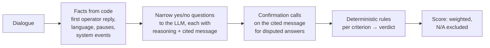

# Automated Quality Assessment of Customer-Support Dialogues with a Local LLM

Final project, **AI Essentials: Theory and Applications** (MSc AI, year 1).
Team: **Aslan Zhumazhanov, Temirlan Zholtayev, Alikhan Khamidulla.**

The system grades customer-support chats and calls of a broker (Russian, Kazakh, English) against an
eight-criterion quality checklist, the way a human QA reviewer does, and justifies every verdict with the
message it rests on. It runs on a laptop GPU with an open-weight model (`qwen3.5:9b` via Ollama), so
dialogues never leave the machine and an evaluation costs nothing.

## 1. Problem and success criteria

**User.** A quality reviewer in a contact centre. Today a reviewer reads a sample of dialogues and fills a
checklist by hand: greeting, needs discovery, identification, consultation quality, empathy, dialogue
management, closing, gross violations. Most dialogues are never reviewed.

**Goal.** Grade every dialogue automatically and leave the reviewer the disputed ones.

**Success criteria** (fixed before the final test):

| Criterion | Target | Why |
|---|---|---|
| Agreement with a human reviewer, per checklist label | ≥ 85% on unseen dialogues | close to the agreement two reviewers usually reach on subjective criteria |
| Every verdict cites a message of the dialogue | 100% | the reviewer must be able to check the verdict in one click |
| Latency on an 8 GB laptop GPU | ≤ 60 s per dialogue | a day of chats is graded overnight |
| Cost and data leaving the machine | $0, none | dialogues contain personal and financial data |

**Why an LLM.** The checklist is written in natural language ("the operator clarified the missing details
before answering"), dialogues are free text in three languages, and there is no labelled corpus large enough
to train a classifier per criterion. A pretrained instruction-following model can apply the written rules
without training data; the problem is making a *small local* model apply them reliably.

## 2. Data

| Set | Size | Labels | Used for |
|---|---|---|---|
| `backend/data/dev_dataset.json` (DEV) | 65 dialogues: 60 chats (RU 30, KZ 15, EN 15) and 5 transcribed RU calls | 19 dialogues labelled by the team (`ml/data/reference/dev_reference.json`) | development of prompts and rules |
| `ml/data/reference/heldout_*`, `calls_*` | 15 other DEV chats + the 5 calls | LLM labels (Gemini Pro, prompts in `ml/docs/*_LABELING_PROMPT.md`), spot-checked by an AI assistant, **not verified by a person** | development only; never reported as a test |
| `ml/data/test/test_dataset.json` (TEST) | 13 dialogues: RU 6, KZ 4, EN 3; 11 chats, 2 calls | written by an annotator outside the development (A. Islyamov) from the checklist PDF, before the model ran | **final evaluation only** |
| `ml/data/test/test_labels_new_criteria.json` | same 13 | 4 criteria the pipeline had never seen | generalisation to new checklist criteria |

Dialogues are JSON records: `conversation_id`, `channel`, `language`, `transcript[]` with `speaker`
(client / operator / bot / system), `text`, `timestamp`. The calls are real conversations with personal data
masked by the provider. Before a dialogue is sent to any non-local model, the backend masks IINs, card
numbers, phones, e-mails and IBANs (`backend/app/ml/pii.py`).

**Split and leakage.** Prompts, rules and thresholds were developed on DEV only. TEST was scored by the
pipeline after development. One exception is documented in §5: after the first TEST run one rule (criterion
02) was changed; we report the score before and after.

**Analysis** (`ml/eval/data_analysis.py` → `ml/results/data_analysis.md`): only 23–27% of messages are
written by the operator, the graded party; labels are imbalanced (in TEST the gross-violation flag is set in
1 of 13 dialogues, 15% of labels are N/A). Leakage check: no client or operator message is shared between
DEV and TEST, and on client/operator text every TEST dialogue is at most as similar to its nearest DEV
dialogue (Jaccard ≤ 0.042 on word 3-grams) as DEV dialogues are to each other (median 0.030, max 0.076).

## 3. Method



* **Narrow questions instead of one judgement.** Each criterion is split into yes/no questions ("Did the
  operator greet the client in the first reply?"). The model sees only the relevant messages, writes its
  reasoning first and must name the message that supports the answer; the JSON schema restricts the
  message to IDs that exist, so the model cannot invent a quotation (`ml/maestro/probes.py`).
* **The verdict and the score are computed by code** from the answers, following the checklist
  (`ml/maestro/rules.py`, `ml/maestro/scoring.py`). Unambiguous cases (a system message "identity
  verified", "operator closed the chat") are decided without the model.
* **Confirmation calls.** When a question returns a damaging answer (e.g. "the client had to ask again"),
  a second question checks exactly the cited message.
* **New criteria** written by the user in the checklist editor are graded by a generic evaluator from
  their wording: applicability (N/A) is decided in a separate call, then the answer (`ml/maestro/generic.py`).
* **Baseline** (`ml/maestro/baseline.py`): the standard *LLM-as-a-judge* setup — the whole checklist
  and the whole dialogue in one prompt, one JSON answer per criterion. Same model, same dialogue rendering,
  same checklist text and general rules.

Settings: temperature 0, seed 42, JSON-schema constrained output, context window sized to the prompt
(8k–32k tokens), `qwen3.5:9b` (Q4_K_M) on Ollama 0.40.5. All prompts are in the source files listed above.

## 4. Results

TEST, 13 dialogues × 8 criteria = 104 labels, same model and conditions for both systems:

| System | Agreement | 95% CI (bootstrap over dialogues) | Score MAE | s / dialogue | LLM calls |
|---|---|---|---|---|---|
| Baseline: one prompt (LLM-as-a-judge) | 69.2% | [59.6%, 77.9%] | 12.1 | 14.3 | 1 |
| **Proposed pipeline** | **85.6%** | [76.9%, 93.3%] | 11.0 | 34.7 | 17.4 |

Paired difference on the same dialogues: **+16.3 points**, 95% CI [+5.8, +26.9].

| Criterion | 01 | 02 | 03 | 04 | 05 | 06 | 07 | 08 |
|---|---|---|---|---|---|---|---|---|
| Baseline | 12/13 | 6/13 | 12/13 | **1/13** | 11/13 | 8/13 | 9/13 | 13/13 |
| Pipeline | 13/13 | 7/13 | 11/13 | 11/13 | 12/13 | 10/13 | 13/13 | 12/13 |

By language, pipeline / baseline: RU 81% / 77%, KZ 91% / 66%, EN 88% / 58%.

* The baseline's largest failure is criterion 04: in 12 of 13 dialogues it answered N/A ("no request
  was formulated") although the client had asked a question. In one holistic answer the model applies the
  N/A conditions loosely; the pipeline decides applicability with its own question first.
* The pipeline's weakest criterion is 02 (needs discovery): 6 of its 15 errors are the choice between N/A
  ("the client gave enough information from the start") and yes/no, a condition that two readers can
  read differently.
* The pipeline is 2.4× slower (17 calls instead of 1) but stays within the 60 s budget.
* The score error is similar (MAE 11.0 vs 12.1): N/A answers drop a criterion and re-weight the rest, so
  many label errors change the final score less than the label agreement suggests.

Full tables (per criterion, per language, errors, every disagreement, paired comparison):
`ml/results/report.md`; raw outputs in `ml/results/main/`.
Earlier measurements: 4 new criteria on TEST 86.5% (one prompt per new criterion); a decomposed variant of the
generic evaluator 76.9% (rejected); thinking mode of Qwen exceeded 4096 tokens per question (rejected).

## 5. Limitations

* TEST has 13 dialogues; the confidence interval is wide (about ±8 points).
* Criterion 02 was changed after the first TEST run (81.7% → 85.6% overall); the 85.6% is therefore not
  fully independent of TEST. The baseline comparison above uses the final code for both systems.
* Correctness of financial facts (tariffs, procedures) is not verified: there is no knowledge base.
* Kazakh explanations were not reviewed by a native speaker.
* GPU inference is not bit-exact; borderline answers can change between runs.

## 6. Responsible use

Scores can affect operators' bonuses, so the system is built as decision support: every verdict cites
its evidence; operators can appeal a criterion; a reviewer confirms or changes it with a reason and the
original model answer stays visible; dialogues with gross violations or low scores go to a review queue
rather than being acted on automatically. Personal data is masked before any cloud model; by default no
cloud model is used.

Masking check (`ml/eval/pii_check.py` → `ml/results/pii_check.md`): 16 of 17 personal values masked in 24
RU/KZ/EN cases, 0 of 9 look-alike numbers (amounts, dates, order numbers) masked. Known gap: international
phone numbers with a four-digit group are not masked.

## 7. Reproduce

Requirements: Python 3.12, [uv](https://docs.astral.sh/uv/), [Ollama](https://ollama.com) ≥ 0.40, ~10 GB
disk; an NVIDIA GPU with 8 GB is recommended.

```bash
ollama pull qwen3.5:9b
cd ml
uv sync                                    # exact versions from uv.lock
uv run pytest -q                           # 111 tests, no model needed
uv run python eval/experiments.py run --tag main --systems single_prompt,pipeline
uv run python eval/experiments.py report   # -> ml/results/report.md, ml/results/tables.tex
uv run python eval/data_analysis.py        # -> ml/results/data_analysis.md (no model needed)
uv run python eval/pii_check.py            # -> ml/results/pii_check.md (no model needed)
```

The full application (web UI, review workflow, appeals): `docker compose up -d --build`, then
http://localhost:8000 (needs Ollama running on the host; see `ml/.env.example`, `backend/.env.example`).

## 8. Contributions and reused components

| Part | Author |
|---|---|
| ML evaluation pipeline, baseline, experiments (`ml/maestro`, `ml/eval/experiments.py`) | Aslan Zhumazhanov |
| Data analysis and DEV/TEST leakage check (`ml/eval/data_analysis.py`) | Temirlan Zholtayev |
| Personal-data masking check, responsible use (`ml/eval/pii_check.py`) | Alikhan Khamidulla |

Reused: web UI and backend (A. Aspandiyar, B. Serikov, A. Islyamov), parts of `ml/` (A. Aspandiyar), TEST
labels (A. Islyamov). Tools: Claude Code as a coding assistant, Gemini Pro for development labels; all code
reviewed and tested by the authors.

## Repository

```
ml/          evaluation pipeline, baseline, experiments, tests — ml/README.md
backend/     FastAPI service: checklists, queue, scoring, appeals (reused)
frontend/    web interface (reused)
docs/        checklist PDF, API contract
```
